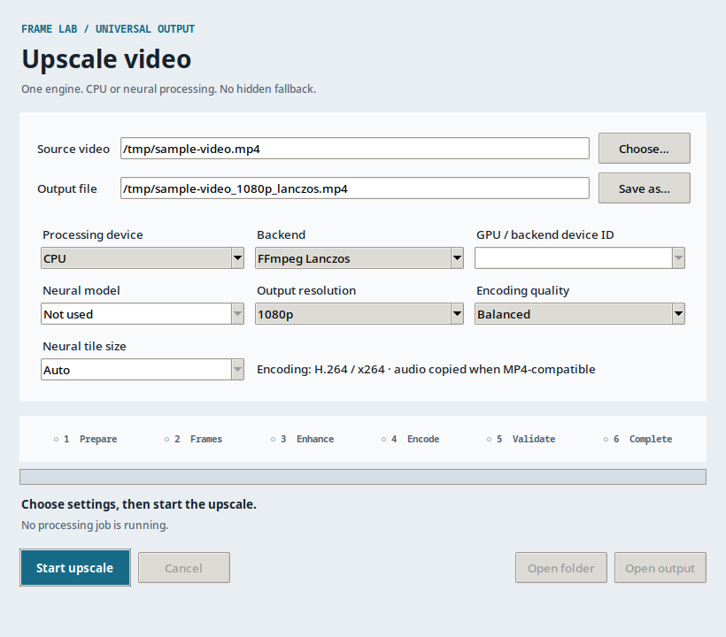

# Universal Linux Video Upscaler

[](https://github.com/pinguy/universal-linux-video-upscaler/actions/workflows/tests.yml)
[](https://www.python.org/downloads/)
[](LICENSE)

A standalone Linux video upscaler with one processing engine, one small GUI and
integrations for KDE Plasma/Dolphin and GNOME/Nautilus.

The minimal installation needs only Python, Tk and FFmpeg. Neural processing is
optional: PyTorch FP32 on CPU or Real-ESRGAN NCNN/Vulkan on a selected GPU.

> **Status: alpha.** CPU Lanczos and NCNN/Vulkan have passed local runtime
> tests on the development machine. See `TESTING.md` for the exact evidence and
> the platform/backend tests that remain unavailable.



## Features

- FFmpeg Lanczos CPU scaling with no ML runtime.
- Genuine Real-ESRGAN CPU inference through optional PyTorch FP32.
- Real-ESRGAN NCNN/Vulkan with explicit backend-native GPU IDs.
- General and anime models when their matching files are installed.
- 720p, 1080p and 4K fit/pad output with no default crop or stretch.
- Fast, Balanced and Quality x264 presets.
- Real stage/frame progress, cancellation, cleanup and notifications.
- Bounded neural-frame batching with one persistent output encoder; no full-video PNG dump.
- Collision protection, isolated temporary data and full output decode checks.
- Dolphin top-level **Upscale Video…** action.
- Nautilus **Scripts → Upscale Video…** baseline plus optional python-nautilus extension.
- CLI that works without a desktop session.

## Requirements

Required:

- Linux
- Python 3.10+
- Tkinter (often packaged as `python3-tk` or `tk`)
- FFmpeg and FFprobe with `libx264`

Optional GPU neural backend:

- Vulkan-capable NVIDIA, AMD or Intel GPU
- `realesrgan-ncnn-vulkan`
- matching NCNN `.param` + `.bin` model pairs

Optional CPU neural backend:

- isolated Python 3.10-3.12 environment
- packages in `requirements-cpu.txt`
- matching PyTorch `.pth` weights

Run `video-upscaler doctor` after installation. It reports which backends are
actually usable instead of treating a detected package or GPU as proof.

## Run from the repository

```bash
./video-upscaler doctor
./video-upscaler devices
./video-upscaler gui /path/to/video.mp4
./video-upscaler run /path/to/video.mp4 --backend lanczos --resolution 1080p
```

NCNN with explicit Vulkan device ID:

```bash
./video-upscaler run input.mp4 --backend realesrgan-ncnn \
  --gpu 1 --model realesrgan-x4plus --resolution 4k --quality quality
```

The device number above is an NCNN/Vulkan ID from `video-upscaler devices`, not
a CUDA or `nvidia-smi` index.

## User installation

```bash
git clone https://github.com/pinguy/universal-linux-video-upscaler.git
cd universal-linux-video-upscaler
./install.sh
```

Automatic mode installs integrations for detected file managers. Explicit modes:

```bash
./install.sh --desktop=kde
./install.sh --desktop=gnome
./install.sh --desktop=all
./install.sh --desktop=none
```

Optional direct Nautilus context entry:

```bash
./install.sh --desktop=gnome --nautilus-extension
```

The baseline Nautilus Script does not require python-nautilus.

Uninstall only application-owned files:

```bash
video-upscaler-uninstall
```

User-supplied binaries and models under `$XDG_DATA_HOME/video-upscaler/bin` and
`models` are outside the installer manifest and are retained.

For NCNN/Vulkan and PyTorch model placement, environment overrides and common
failure modes, see [`docs/TROUBLESHOOTING.md`](docs/TROUBLESHOOTING.md).

## Bounded neural processing

Neural jobs do not extract an entire video to disk. FFmpeg streams decoded PNGs
into a bounded batch, Real-ESRGAN processes that batch, and the enhanced frames
are fed into one persistent FFmpeg encoder. Only the current input and enhanced
batch exist in the temporary workspace.

The real full-length acceptance run processed an 8,976-frame, 598.421-second
video in 75 NCNN batches. Temporary storage peaked at **170.86 MiB** and **240
PNGs** (120 input + 120 enhanced), stayed bounded for the whole run, preserved
audio, passed a complete independent decode and cleaned up after completion.
See [`TESTING.md`](TESTING.md) for the measured result.

Output is written to a uniquely named partial file, validated for dimensions,
frame count, duration, audio and full decode, then atomically moved into place.
Failure or cancellation removes the partial output and isolated workspace. Job
logs are kept under `$XDG_STATE_HOME/video-upscaler/logs` (normally
`~/.local/state/video-upscaler/logs`).

## Encoding presets

| GUI preset | x264 preset | CRF |
|---|---:|---:|
| Fast | veryfast | 22 |
| Balanced | medium | 18 |
| Quality | slow | 16 |

Hardware encoding is deliberately not advertised in 0.1. Finding an encoder in
`ffmpeg -encoders` is not proof that its driver/device/pixel-format path works.
Scaling backend and encoding remain separate so verified encoders can be added
without redesigning the engine.

## Model separation

- NCNN/Vulkan: `.param` + `.bin`
- PyTorch CPU: `.pth`

These formats are not interchangeable. The project does not download or bundle
large optional dependencies or models.

## Documentation

- `docs/ARCHITECTURE.md`
- `docs/TROUBLESHOOTING.md`
- `TESTING.md`
- `THIRD_PARTY.md`

## Development

The test suite uses the standard library's `unittest`. FFmpeg/FFprobe enable
the probe integration test; it is skipped when they are unavailable.

```bash
PYTHONPATH=src python -m unittest discover -s tests -v
ruff check src tests
```

## Licence

MIT. External tools and models retain their own licences; see `THIRD_PARTY.md`.

Built by Antoni Norman with heavy AI-assisted development, manual testing,
direction, tuning, and final integration.
